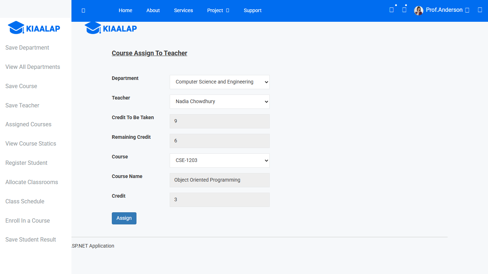
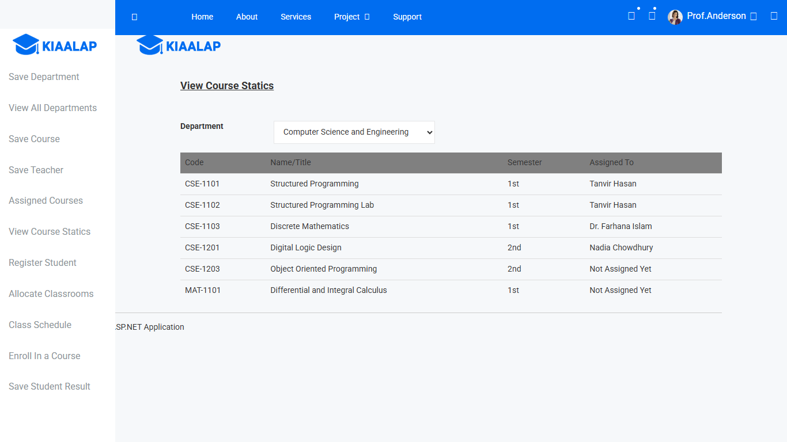
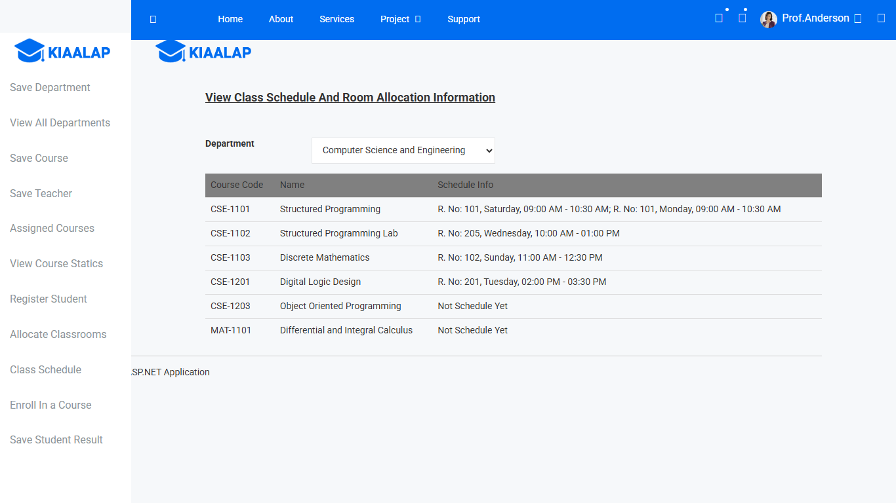
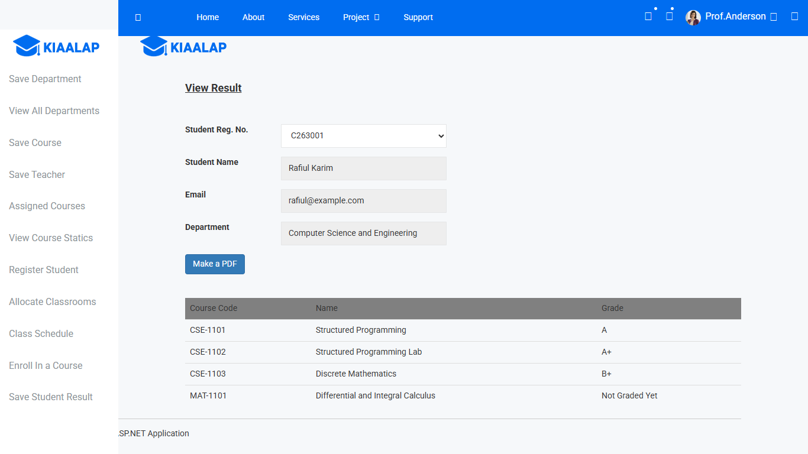
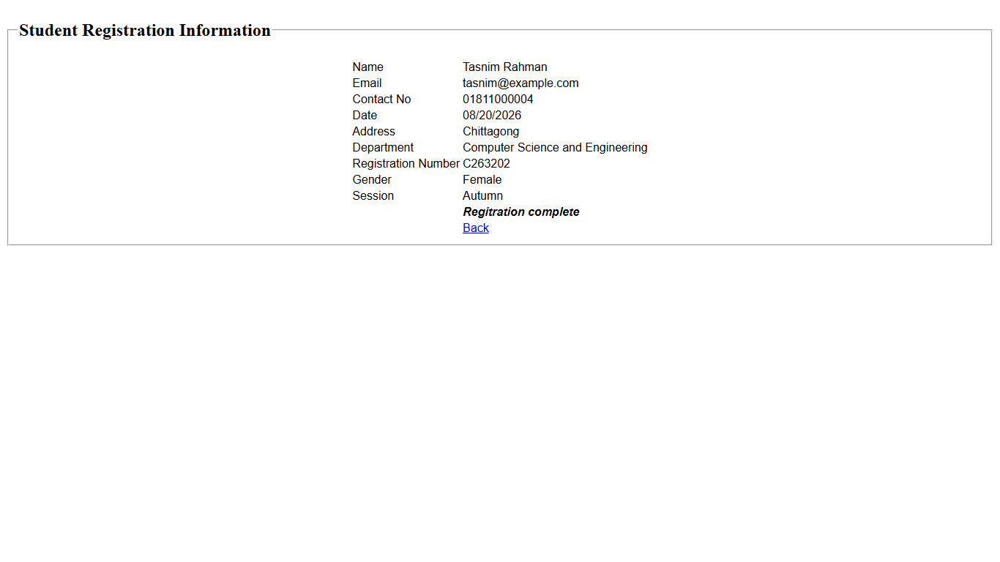

# University Course and Result Management System

A web application for running a university department's courses and results: departments, courses, teachers, course assignment, student registration, classroom scheduling, enrolment, grades and printable result sheets.

I built it in 2019 as an undergraduate project, with ASP.NET MVC 5, C# and SQL Server, using hand-written SQL (ADO.NET). In 2026 I came back to it, rebuilt the missing database script, and fixed five bugs I found when reviewing the code. See [What changed in 2026](#what-changed-in-2026).

## Screenshots

**Assigning a course to a teacher.** The teacher's credits and the course's credit are filled in as you choose:



**Course statistics.** Who teaches each course of a department:



**Class schedule.** Every room booking of each course:



**A student's result.** It can also be downloaded as a PDF:



**After registering a student.** The registration number is created automatically:



## Features

- Departments, courses (with credits and semester) and teachers (with the number of credits each should take)
- Assigning courses to teachers. The teacher's remaining credit goes down, with a warning when it would drop below zero
- Course statistics per department: which teacher has each course
- Student registration with an automatic registration number such as `C263001`: the department's first letter, the year, the session (1 = Spring, 3 = Autumn), gender (0 = male, 2 = female) and a serial number
- Classroom allocation by room, day and time, refusing bookings that overlap
- Class schedule per department
- Course enrolment, grades, and a result sheet that downloads as a PDF
- "Unassign all courses" and "Unallocate all rooms" for starting a new semester

## How it is built

- **ASP.NET MVC 5** on .NET Framework 4.5: Razor views, with jQuery AJAX for the dropdowns and tables that depend on an earlier choice, and Bootstrap with the Kiaalap admin template for the layout
- **Three layers**: controllers take the request, managers apply the rules (for example "is this course already assigned?"), and gateways run the SQL (ADO.NET, no ORM)
- **SQL Server**: 12 tables, plus 6 views that the read-only screens use
- **iTextSharp** for the PDF result sheet

## What changed in 2026

The original 2019 Git repository was not kept. The 2019 history here was rebuilt in October 2026 from the original files' last-saved dates: one commit for each day on which files were saved, from 9 August to 8 October 2019. Everything after that is 2026 work:

1. A `.gitignore`.
2. [`Database/UniversityCourseManagement.sql`](Database/UniversityCourseManagement.sql): the database script, rebuilt from what the code expects, because the original was not kept.
3. Fixes for five bugs. I reproduced each one on the 2019 code first by sending requests to the real forms, then checked the same scenario after the fix.

| Bug | What happened with the 2019 code (local tests) | Fix |
|---|---|---|
| Teacher credit lost | Two open pages each assigned a 3-credit course to a teacher with 6 credits left. Both saved "6 − 3", leaving 3 instead of 0. 20 simultaneous requests for one course created 13 assignments. | One transaction locks the course's assignment row, saves the assignment, and subtracts the course's credit inside the database. |
| Duplicate registration numbers | The 11th student in a group got the 1st student's number, because the serial was read from the wrong position. CSE and CE students got the same numbers. 10 students registered at the same moment all got `C193201`. | The serial is the highest one already used with that prefix, in any department. It is picked and saved in one locked transaction. |
| "Unassign all courses" could stop half-way | With its second step forced to fail, the teachers' credits were reset but every course stayed assigned. | Both steps run in one transaction. |
| Room clash check | A free slot was refused because of a booking in another room on another day. Times were compared as text, so 12:00–12:30 PM was accepted in a room already booked 11:00 AM–01:00 PM. A booking that ended before it started was accepted. 20 simultaneous requests for one slot saved 17 bookings. | It checks the same room, the same day and overlapping times (compared as times, not text), requires the end to be after the start, and checks and saves in one locked transaction. |
| SQL injection | A name with an apostrophe, such as Women's Studies, crashed the page. The department code `'OR''='` was reported as already taken. | Parameters in every query. |

Known limitations I have not fixed:

- There is no login, so every page is open to anyone.
- Form rules (required fields, lengths) are only checked in the browser, not on the server.
- The other "does this already exist?" checks (department, course, teacher and student emails, enrolment, results) are still separate check-then-save steps, so two simultaneous requests could still create a duplicate.
- The AJAX tables insert text into the page as HTML.
- Dates are read in the server's format (month/day/year on an en-US server).
- Some theme icons don't show, because the theme's CSS points to a fonts folder that doesn't exist.

## Running it

You need Windows, Visual Studio 2017 or newer with ASP.NET, and SQL Server 2017 or newer (LocalDB is enough).

1. Create the database and run the script:

   ```
   sqlcmd -S "(localdb)\MSSQLLocalDB" -Q "CREATE DATABASE UniversityCourseManagement"
   sqlcmd -S "(localdb)\MSSQLLocalDB" -d UniversityCourseManagement -i Database\UniversityCourseManagement.sql
   ```

2. In `UniversityCourseManagementSystem/Web.config`, point the `UniversityManagementConnectionString` connection string at that database, for example `Data Source=(localdb)\MSSQLLocalDB;Initial Catalog=UniversityCourseManagement;Integrated Security=True`.
3. Open `UniversityCourseManagementSystem.sln`, let Visual Studio restore the NuGet packages, and run it with IIS Express. The project targets .NET Framework 4.5; if that targeting pack isn't installed, retarget the project to 4.8 or build with `msbuild -p:TargetFrameworkVersion=v4.8`.

The script adds the semesters, designations, grades and rooms. Everything else is added through the pages.
